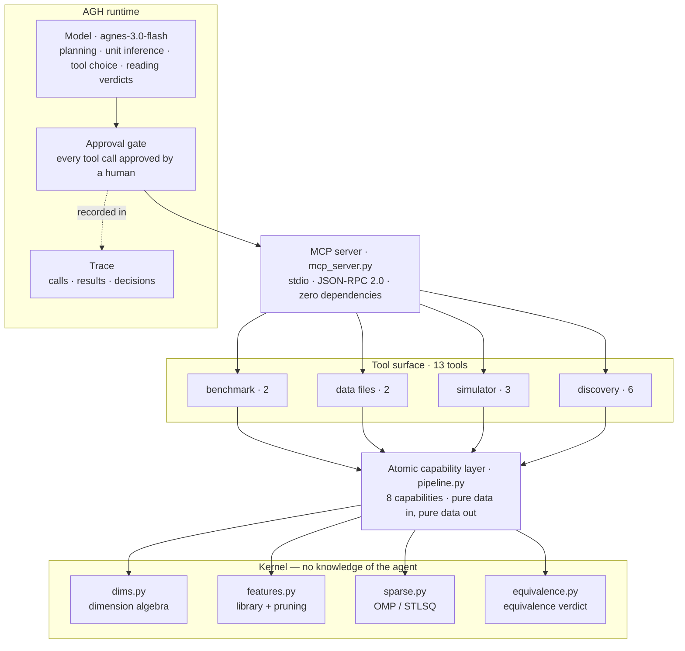

# SciFormula

English | [简体中文](README.zh-CN.md)

<div align="center">

### Dimension-aware discovery of physical laws

**From noisy observations to a closed-form law — by pruning the search space with dimensional homogeneity before any fitting happens.**


[Quick start](#quick-start) · [Project overview](#project-overview) · [Demo video](#demo-video) · [Architecture](#architecture) · [Integration standards](#integration-standards) · [Results](#results) · [中文](README.zh-CN.md)

</div>

<p align="center">
  <sub>Runs as a governed tool surface on <a href="https://github.com/AgnesAI-Labs/agnes-harness">Agnes Harness (AGH)</a>:
  13 tools over MCP, every call approved by a human, every call recorded in the trace.</sub>
</p>

A black-box regressor can reach a training R² of 0.999 and still be useless one step outside the data it saw. SciFormula takes the opposite route: it returns a **closed-form formula**, and it uses a physical constraint — **every term of a physical law must have the dimension of the target quantity** — to delete 99% of the search space before regression starts.

The result is not a better fit. It is an answer that can be **extrapolated, checked and argued with**.

<details>
<summary><kbd>Contents</kbd></summary>

- [Project overview](#project-overview)
- [Demo video](#demo-video)
- [Architecture](#architecture)
- [Integration standards](#integration-standards)
- [Results](#results)
- [Quick start](#quick-start)
- [Repository layout](#repository-layout)
- [Evidence and reproducibility](#evidence-and-reproducibility)
- [Known limitations](#known-limitations)
- [Status](#status)
- [FAQ](#faq)
- [License](#license)

</details>

> **Where the deep documentation lives.** The full technical write-up — stage-by-stage explanation, every design pitfall, and how each number is verified — is maintained in Chinese at **[docs/technical-notes.zh-CN.md](docs/technical-notes.zh-CN.md)** (sections 一–八, ≈950 lines). Older documents and code comments that cite `README §N` refer to those sections; their numbering is preserved there unchanged.

---

## Project overview

### Background: fitting well is not the same as finding the law

Symbolic regression searches for an expression that explains observations. Most of that search is wasted: of the millions of candidate terms a generic library produces, almost all are **physically impossible** — `m·v` can never be a term in an energy formula, because its dimension is not energy.

SciFormula makes that observation the core mechanism. Dimension checking is not a post-hoc sanity check here; it is the **pruning step that runs before fitting**.

The consequence shows up most clearly against black-box baselines on the same 300 runs (100 official Feynman equations × 3 noise levels), scored by the same protocol (`verify_formula` defaults: in-range nRMSE ≤ 0.05, extrapolation nRMSE ≤ 0.20):

| Method | Training R² (median) | In-range nRMSE | Extrapolation nRMSE | Passes both gates | Outputs a formula |
|---|---|---|---|---|---|
| **SciFormula (dimensional pruning + OMP)** | 1.000 | **0.0041** | **0.0356** | **171 / 300 (57%)** | **yes** |
| Gradient boosting (scikit-learn) | 0.999 | 0.3277 | 0.5461 | 3 / 291 (1%) | no |
| Random forest (scikit-learn) | 0.979 | 0.3912 | 0.6128 | 3 / 291 (1%) | no |

The three training R² values are nearly identical. The pass rates are **57% vs 1%**. The entire gap comes from whether the model can leave the observed interval — which is exactly what a physical law is supposed to do.

### Core capabilities

- **Reads observations only.** A dataset is a CSV of variable values and a measured target: no units, no ground-truth formula. Units are inferred by the model from variable names and physical context, then checked as *notation*, not as physics.
- **Builds and prunes a candidate library.** Candidate terms are generated, then filtered by dimensional homogeneity against the target quantity. On the official benchmark this cuts **2,492,610 candidates to 22,368 — 99.1%**.
- **Fits sparsely.** Orthogonal matching pursuit (OMP) selects a few terms; the number of terms is chosen on a held-out split, preferring the simplest model inside the statistically indistinguishable band.
- **Verifies independently, and is allowed to say no.** `verify_formula` resamples fresh points inside the training range, then a further 30% outside it, applies a sign-plausibility check, and returns `passed` / `invalid` / `implausible` / `underfit` / `overfit`.
- **Runs as an agent tool surface, not a script.** All 13 tools are exposed over MCP so AGH can plan, call, read the feedback and retry — with a human approval on every call.

### Innovation highlights

**1. Prune before you fit — and measure what the pruning is worth.**
The ablation holds everything else fixed and only disables dimensional pruning (`SCIFORMULA_NO_PRUNE=1`):

| Variant | Exact recovery (noise-free) | Passes both gates (0 / 1% / 2%) | Candidates kept |
|---|---|---|---|
| With pruning (default) | **36 / 100** | **54 / 54 / 57** | 22,368 |
| Without pruning | 20 / 100 | 29 / 29 / 29 | 63,036 |

The prior is worth **+25 passes** and costs nothing but a filter. Speed is only a side effect (145.7 s → 129.5 s on the development machine — the ≈12% ratio is the finding, not the absolute seconds): the expensive part is generating and evaluating expressions, not the regression.

**2. A verification gate that rejects a perfect fit.**
On `P19` (the relativistic factor) the library *does* contain a near-miss basis function. The fit reaches **training R² = 1.00000** and is rejected by extrapolation with **R² = −5.20476**. That distinction matters: "the library cannot express it" is a capability limit; "the fit was perfect and the gate caught it" is the mechanism working.

Ablating the gate on 255 scorable official results quantifies it:

| Acceptance rule | Admitted | Structurally wrong among them | False-positive rate |
|---|---|---|---|
| Training fit only (R² ≥ 0.99) | 195 | **5** | **2.6%** |
| + in-range resampling | 172 | 0 | **0.0%** |
| + 30% extrapolation | 171 | 0 | 0.0% |
| + sign plausibility | 169 | 0 | 0.0% |

The dangerous errors are the ones with R² ≈ 0.9999. One resampling pass removes all of them, at the cost of rejecting 9 correct formulas out of 178 — a trade this project makes deliberately, since an agent can always retry.

**3. Physical constraints as executable rules, not prose.**
Two rules are enforced in code rather than described in a paper:

- **Dimension algebra.** A formula is parsed into a symbolic expression and its dimension is derived *from the structure* — multiplication adds exponent vectors, division subtracts, powers scale. No numerical experiment is involved, so any expression gets a definite answer. The same mechanism cross-checks every equation's declared unit against the dimension its formula actually computes.
- **An additive constant is only legal when the target is dimensionless.** This rule exists because an AGH agent found the one loophole: the intercept is the only free parameter that bypasses dimension checking. `0.5·m·v² − 1.204` passed every numeric gate with in-range nRMSE 0.0034 while predicting **negative kinetic energy** (−1.07 where the truth is 0.14). The fix is derived from the claim itself, not patched around it.

**4. Resources are replaceable, and validation can be an experiment.**
Observations exist as files on disk and as a drivable numerical bench (RK4 integration, 4 scenarios). For simulator datasets, `verify_formula` **re-runs the simulation with held-out parameters at verification time** and compares against the measured reading — the reference fact is an experiment performed then, not a stored answer. Measurement error against the closed-form solution is **1.5 × 10⁻¹²** across 12 parameter points.

**5. Determinism as a tested property, not an intention.**
An earlier version drifted between 53/53/56 and 52/52/55 across runs. The cause was a `set` iteration order leaking into a truncated candidate list under randomized string hashing. After adding a total order, three different `PYTHONHASHSEED` values produce byte-identical formulas. This was found by an ablation that required re-running the full benchmark — not by reading the code.

### What this project is not

- **Not a theorem prover.** "Is the recovered formula the true one?" is decided by **numerical equivalence** over sampled points, not by symbolic proof. `exact` means "agrees wherever the test points reach". There is no Lean/Coq proof, no formal semantics, no machine-checkable proof object.
- **Not a claim of new physics.** The laws in the simulator are the ODEs we wrote. Its value is that AGH can drive a measurable, repeatable bench and that verification performs a real experiment.
- **Not a general-purpose solver.** The candidate library is finite: 15 of 100 official equations need structures it cannot express, and those are reported as capability limits rather than hidden.
- **Not a 95% method.** The built-in 21-equation teaching library gives 95.2%; the official Feynman benchmark gives 54–57%. Both are published side by side on purpose.

---

## Demo video

| Version | Link | Narration | Added |
|---|---|---|---|
| Chinese (primary) | **[bilibili · BV1YKpu6ECi](https://www.bilibili.com/video/BV1YKpu6ECi)** | Chinese | 2026-10-07 |
| English | **[MP4 in this repository](docs/assets/demo/demo-en.mp4)** — 4:06, 1080p | English | 2026-10-29 |

The English cut follows the same demo flow with English narration and is stored in the repository
(16.9 MB, H.264) rather than behind a platform link: a recording you can open offline is part of the
evidence, and links expire.

The recording walks the loop end to end on the simulator bench: pick a scenario, drive a sweep, load the resulting dataset, infer units, prune, fit, verify — and show the trace of approvals alongside it.

**Watch it, then reproduce it in about a minute:**

```bash
git clone https://github.com/Arcticfox-star/SciFormula.git
cd SciFormula
pip install numpy sympy
python scripts/run_all.py        # 9 self-checks + evidence verification, ~20 s
```

---

## Architecture

SciFormula is deliberately layered so that the **same implementation** serves the agent and the batch benchmark. There is no "demo path" and "real path".



### Three layers, three responsibilities

| Layer | Files | Owns | Must not |
|---|---|---|---|
| **Tool surface** | `agh_tools.py`, `mcp_server.py` | Validation, JSON shaping, logging, protocol | Contain any physics |
| **Atomic capabilities** | `pipeline.py` | One decision-free step per capability; identical path for agent and benchmark | Decide *when* to stop or *which* strategy to use |
| **Kernel** | `dims.py`, `features.py`, `sparse.py`, `equivalence.py` | Mathematics: dimension vectors, candidate generation, regression, equivalence | Know that an agent exists |

The split exists for a specific reason: if the orchestration layer has nothing to decide, then "the agent ran it" is cosmetic. Every stage that *could* be automated was pushed down into the kernel, and everything that requires judgement — which units, whether the pruning result is plausible, whether to retry, whether to accept the verdict — was left to the model.

### The discovery loop

| # | Stage | Tool | Produces | What the model must decide |
|---|---|---|---|---|
| 1 | Load observations | `load_problem` / `load_dataset` | `data_id` | Which problem or dataset |
| 2 | Infer units | `check_units` | normalized exponents, warnings | The units themselves — the only source of physics |
| 3 | Build and prune | `build_candidate_library` | `library_id`, kept/total | Whether `kept = 0` means "retry units" |
| 4 | Fit | `fit_sparse` | `formula`, `formula_readable` | Strategy and `max_terms` |
| 5 | Verify | `verify_formula` | `passed`, `verdict`, reason | Whether to accept, retry or change units |
| 6 | Score (benchmark only) | `score_prediction` | verdict vs. truth | Nothing — this tool is not available in discovery mode |

### Key design decisions

| Decision | Why |
|---|---|
| Prune before fitting, not after | Removes only physically impossible terms, so nothing recoverable is lost — and it regularizes the regression, not just speeds it up |
| OMP over STLSQ | STLSQ's threshold on a training-only criterion failed on noisy data; OMP is robust to collinearity. Both stay available, and `compare_strategies` runs them side by side so the claim is testable |
| Numeric equivalence, stated as such | Symbolic proof is a different research programme (Lean/mathlib). Calling numeric agreement a proof would be wrong, so the module says what it is |
| Intercept forbidden unless the target is dimensionless | The only free parameter that escapes dimension checking; leaving it open produced physically impossible formulas |
| Deterministic ordering everywhere | Randomized `set` iteration once made published numbers irreproducible across processes |

Retry handling lives in the model, not in a script: when `build_candidate_library` returns `candidate_kept = 0`, the loop goes back to unit inference; when `verify_formula` returns `overfit`, it refits with fewer terms. Both paths are visible in the recorded AGH sessions.

---

## Integration standards

Everything below is an interface contract. The goal is that another harness, or another person's script, can drive these capabilities without reading the source.

### Transport and protocol

| Item | Value |
|---|---|
| Transport | **MCP over stdio** — newline-delimited JSON-RPC 2.0, one message per line |
| Server identity | `name: "sciformula"`, `version: "0.1.0"` |
| Methods | `initialize`, `notifications/initialized`, `tools/list`, `tools/call`, `ping` |
| Encoding | UTF-8 on stdio, forced at startup (Windows defaults to a non-UTF-8 code page) |
| stdout | Protocol messages only; all logging is redirected to stderr |
| Dependencies | Python standard library only — no MCP SDK required |

The server is a plain Python process, so the executable you register is the **interpreter**, and the script path is passed as a separate argument. This is also what AGH's own guidance asks for ("do not pass a complete shell command as the executable").

### Tool contract

All 13 tools follow one shape, so a client can treat them uniformly.

| Aspect | Contract |
|---|---|
| Input | A single JSON object; unknown parameters are rejected with the accepted list, missing required parameters are named explicitly |
| Success | `{"ok": true, ...}` plus tool-specific fields |
| Failure | `{"ok": false, "error": "...", "hint": "..."}` — a failure is **feedback, not an exception** |
| Exceptions | `run_tool` never raises: every error is converted into a readable result so the agent can correct itself |
| Serialization | NaN/Inf become `null`, NumPy scalars become native JSON types — output is always strict JSON |
| Chaining | Tools pass opaque ids (`data_id`, `library_id`) forward; nothing is inferred from global state |
| Determinism | Same inputs and seed produce the same output; no wall-clock or hash-order dependence in results |
| Logging | Every call is appended to a local JSONL log with duration and error class |

### The 13 tools

| Tool | Group | Key parameters | Returns |
|---|---|---|---|
| `list_problems` | benchmark | `library` | Problem ids, names, target and variable names |
| `load_problem` | benchmark | `problem_id`, `n_samples`, `noise`, `seed`, `mode` | `data_id`, ranges, observation preview — **no units, no formula** in discovery mode |
| `list_datasets` | data files | — | Dataset names, paths, row counts, columns |
| `load_dataset` | data files | `name` | `data_id`, statistics, preview, `verification` capability |
| `list_simulations` | simulator | — | Scenario ids, settable parameters, measured readings |
| `run_simulation` | simulator | `scenario`, `params`, `preview_points` | Full time series (CSV on disk) and one reading |
| `run_sweep` | simulator | `scenario`, `n_cases`, `noise`, `seed` | Dataset of parameter → reading pairs |
| `check_units` | discovery | `variables_units`, `target_unit`, `data_id` | `parsed_ok`, normalized exponent form, warnings |
| `build_candidate_library` | discovery | `data_id`, `variables_units`, `target_unit`, `max_terms` | `library_id`, total/kept, prune percentage |
| `fit_sparse` | discovery | `library_id`, `data_id`, `strategy`, `max_terms`, `threshold` | `formula` (full precision), readable form, terms, R² |
| `verify_formula` | discovery | `formula`, `data_id`, `expand`, `n_samples`, `tol_in_range`, `tol_extrap` | `passed`, `verdict`, reason, nRMSE in-range/extrapolation |
| `compare_strategies` | discovery | `library_id`, `data_id` | OMP vs STLSQ side by side |
| `score_prediction` | discovery | `formula`, `data_id` | Verdict against truth — **benchmark mode only** |

Two deliberate exclusions: `score_prediction` refuses to run in discovery mode, and the post-hoc scorer (`posthoc_eval.py`) is **not** a tool at all. Ground truth must not be reachable from inside a session, or "discovering a law" degrades into "copying the answer".

### Registering with AGH

```sh
# 1. Register. --name is required; the display name is not optional.
node packages/cli/dist/local/agnes.mjs mcp add sciformula \
  --name SciFormula \
  --stdio "D:\SciFormula\.venv\Scripts\python.exe" \
  --arg "D:\SciFormula\mcp_server.py"

# 2. Read the revision (read-only).
node packages/cli/dist/local/agnes.mjs mcp get sciformula

# 3. Trust and enable (interactive confirmation).
node packages/cli/dist/local/agnes.mjs mcp enable sciformula

# 4. Verify: the tool count must match `python agh_tools.py list`.
node packages/cli/dist/local/agnes.mjs mcp tools sciformula
```

Two operational notes, both encountered in practice:

- **Write operations require a real TTY.** AGH refuses to proceed without `stdin`/`stdout` being terminals and offers no bypass flag; scripting the registration silently reports `operation cancelled`. Read-only commands are unaffected.
- **Registration is per-machine configuration, not repository state.** The absolute paths above must be adapted to the local clone.

### Data interface

An observation dataset is an ordinary CSV, and that is the whole extension mechanism:

```
m_0,v,c,m
3.547846749,1.319681636,4.415176658,3.727411286
...
```

| Rule | Detail |
|---|---|
| Shape | Header row with variable names; one column per variable plus the target column |
| Size | 200 data rows per file in the bundled datasets |
| Forbidden content | No units, no formula, no ground truth — deliberately absent |
| Naming | `data/observations/<problem-or-dataset-id>.csv`; the filename becomes the dataset name |
| Encoding | UTF-8; files that carry a BOM are read with `utf-8-sig` |
| Replacement | Dropping a CSV in the same shape into that directory makes it usable with no code change |

### Simulator interface

The bench exposes four scenarios. Parameters are set by the caller; readings are produced by post-processing an integrated trajectory, never by evaluating the closed-form solution.

| Scenario | Settable parameters | Measured reading | Measurement method |
|---|---|---|---|
| `spring_period` | `m`, `k`, `A` | Period `T` | Zero-crossing detection with linear interpolation |
| `damped_decay` | `m`, `k`, `c`, `A` | Envelope decay constant `γ` | Log-linear regression on the peak envelope |
| `rc_discharge` | `R`, `C`, `V0` | Time constant `τ` | Linear regression of `ln V` against `t` |
| `kepler_speed` | `M`, `a`, `G` | Specific kinetic energy `ε` | Average over the full trajectory |

`A` and `V0` are distractors: they are set by the experimenter and do not affect the reading. They are present on purpose, because real experiments contain variables that look relevant and are not. `run_sweep` materializes a sweep as a dataset in the same CSV format, so the discovery loop is identical for simulated and measured data.

### Verification standard

`verify_formula` is the only gate, and its thresholds are explicit:

| Parameter | Default | Meaning |
|---|---|---|
| `expand` | `0.3` | Extrapolation window as a fraction of the training range |
| `n_samples` | `100` | Fresh points drawn per region |
| `tol_in_range` | `0.05` | Normalized RMSE ceiling inside the training range |
| `tol_extrap` | `0.20` | Normalized RMSE ceiling in the extrapolation window |

| Verdict | Condition | Counts as recovered |
|---|---|---|
| `invalid` | Formula cannot be evaluated on the test points | no |
| `implausible` | Sign plausibility violated (observations single-signed, prediction changes sign) | no |
| `underfit` | In-range nRMSE above tolerance | no |
| `overfit` | In-range acceptable, extrapolation above tolerance | no |
| `passed` | Both regions within tolerance and sign-consistent | **yes** |

A formula is never accepted on training fit alone. When the target is dimensionless the intercept is allowed; otherwise it is forced to zero.

### Evidence standard

Reproducibility claims are backed by two manifests with **different strictness**, and the difference is the point:

| Manifest | Covers | Comparison |
|---|---|---|
| `results/EVIDENCE.sha256` | 46 immutable artefacts: AGH exports, trace summaries, scorecards, and the pinned scoring inputs (`.npz` + `.meta.json`) | Byte-for-byte; line-ending differences are reported but tolerated for text |
| `results/SNAPSHOTS.sha256` | 4 generated artefacts: `detailed*.csv`, `report*.html` | Canonical form — timing columns and generation timestamps are stripped before hashing |

Binary files are compared byte-for-byte with no line-ending tolerance, and official AGH exports are marked `-text` in `.gitattributes` so git never rewrites them. `verify_evidence.py` exits non-zero on any mismatch.

### Runtime requirements

| Item | Requirement |
|---|---|
| Python | 3.10 or later |
| Direct dependencies | `numpy>=1.24`, `sympy>=1.12` (sympy pulls `mpmath`) |
| Hardware | No GPU; full benchmark completes in roughly 2 minutes on a laptop CPU |
| Network | Not required at runtime |
| Platform | Windows, macOS and Linux; the MCP server forces UTF-8 on stdio |

---

## Results

Same code, same default configuration. Both libraries are reported side by side because the teaching library alone would be misleading.

**Built-in teaching library — 21 equations × 3 noise levels (≈6 s):**

| Noise | Exact recovery | Structurally correct | Passes both gates |
|---|---|---|---|
| 0% | **20 / 21 (95.2%)** | 20 / 21 | **20 / 21 (95.2%)** |
| 1% | 0 / 21 | 21 / 21 | **20 / 21 (95.2%)** |
| 2% | 0 / 21 | 19 / 21 | **20 / 21 (95.2%)** |

**Official Feynman benchmark — 100 equations × 3 noise levels (≈2 min):**

| Noise | Exact recovery | Structurally correct | Passes both gates |
|---|---|---|---|
| 0% | **36 / 100** | 58 / 100 | **54 / 100** |
| 1% | 0 / 100 | 61 / 100 | **54 / 100** |
| 2% | 0 / 100 | 59 / 100 | **57 / 100** |

Exact recovery is only meaningful without noise: coefficients cannot be reproduced exactly from noisy data, which is why the field measures symbolic recovery on clean data and robustness on noisy data.

**Same-category comparison — gplearn on the full 1% noise slice (100 equations):**

| Method | Structurally correct | Extrapolation nRMSE | Passes both gates | Time per problem |
|---|---|---|---|---|
| **SciFormula** | **61 / 85** | **0.0439** | **58 / 85 (68%)** | **0.14 s** |
| gplearn (default function set) | 28 / 97 | 0.3518 | 25 / 97 (26%) | 5.46 s |
| gplearn (+ sin/cos/tan/exp/tanh) | 17 / 97 | 0.4520 | 13 / 97 (13%) | 6.38 s |

One counter-intuitive finding is kept because it supports the design: **enlarging gplearn's function set made it worse** (28/97 → 17/97) under a fixed search budget. A bigger space dilutes exploration; spending the budget after pruning is more effective than spending it on a richer dictionary.

**Unit inference — 12 problem cards, no units given:**

| Metric | Result |
|---|---|
| Variable-level accuracy | **45 / 54 (83%)** |
| Problem-level accuracy | 6 / 12 (50%) |
| Unanswered (explicitly declared) | 4 |

The failures concentrate on ambiguous variable names (`sigma`, `Nn`) rather than on exotic units: variables with clear physical context, including `G` in N·m²/kg², are inferred correctly. Where the model cannot decide, it says so instead of inventing a unit.

---

## Quick start

```bash
git clone https://github.com/Arcticfox-star/SciFormula.git
cd SciFormula
pip install numpy sympy

python scripts/run_all.py        # 9 self-checks + evidence verification
python verify_evidence.py        # evidence only (46 immutable + 4 snapshots)
```

To run the official benchmark instead of the teaching library:

```bash
SCIFORMULA_LIBRARY=feynman python experiment.py           # with dimensional pruning
SCIFORMULA_LIBRARY=feynman SCIFORMULA_NO_PRUNE=1 python experiment.py   # ablation
```

> **If you see `ModuleNotFoundError: No module named 'numpy'`**, the wrong interpreter is being used — the dependencies are installed elsewhere (typically `.venv`). This is not a broken project. Use `.venv\Scripts\python.exe` (Windows) or `.venv/bin/python`. The two entry scripts, `scripts/run_all.py` and `scripts/show_test_cases.py`, detect and switch to `.venv` automatically.

To drive it from an agent, register the MCP server as shown in [Integration standards](#registering-with-agh). The single-file check that the wiring is correct, without AGH installed:

```bash
python mcp_server.py --selftest     # protocol, tool list, a bad call, a real call
```

---

## Repository layout

```
SciFormula/
├── dims.py                  # dimension algebra: 7-exponent vectors, fractional powers
├── equations.py             # 21-equation teaching library + observation generator
├── features.py              # candidate library construction and dimensional pruning
├── sparse.py                # OMP / STLSQ, with and without intercept
├── equivalence.py           # numerical equivalence verdict
├── pipeline.py              # atomic capability layer (8 capabilities)
├── agh_tools.py             # tool registry: 13 tools, validation, logging
├── mcp_server.py            # MCP server over stdio, zero dependencies
├── simulator.py             # RK4 bench: 4 scenarios, 12 readings per sweep
├── datasets.py              # disk-backed observation datasets
├── experiment.py            # batch benchmark and HTML report
├── verify_evidence.py       # manifest verification (two strictness levels)
├── agh_provenance.py        # model provenance ledger, recomputable from raw events
├── posthoc_eval.py          # session scorecards (deliberately not a tool)
├── data/
│   ├── FeynmanEquations.csv # official 100-equation benchmark
│   └── observations/        # 100 observation CSVs (no units, no formulas)
├── docs/
│   ├── assets/demo/demo-en.mp4   # English demo recording (4:06, 1080p)
│   ├── technical-notes.zh-CN.md  # deep technical write-up (Chinese)
│   ├── model-declaration.md      # which model, where, how it is called
│   ├── tech-info-declaration.md  # data / code / solver / interfaces
│   └── test-cases.md             # normal, boundary and failure cases with commands
├── results/                 # AGH exports, traces, scorecards, manifests
└── scripts/                 # run_all, evidence re-signing, baseline runners
```

9,562 lines of Python across 34 files (7,701 excluding blanks and comments), 243 tracked files.

---

## Evidence and reproducibility

Every number in this README is regenerable, and the evidence has three independent layers:

| Layer | What it proves | How to check |
|---|---|---|
| Deterministic pipeline | The result does not depend on the machine | `python scripts/run_all.py`; identical seeds, no wall-clock in results |
| Immutable evidence | The artefacts were not edited after generation | `python verify_evidence.py` — 46 byte-exact + 4 canonical |
| Model provenance | Which model actually ran, and that a human approved each call | `python agh_provenance.py --check`, recomputed from raw AGH event logs |

Seven AGH sessions are archived as exported HTML plus raw JSONL event streams: 2,085 events, 92 tool calls, 68 human approvals, 4 rejections. The model name exists only in the raw event logs, not in the HTML exports — so the ledger is computed from the logs and can be recomputed by anyone.

<details>
<summary>The seven archived AGH sessions</summary>

| Session | What happened | Tool calls | Approvals (rejected) |
|---|---|---|---|
| `6ea6a59e-2c25-47f8-96b9-e000383a5a93` | RC discharge bench, the run shown in the demo — passes first time | 7 | 7 (0) |
| `6501b3a2-515a-4ce2-bce6-6dc59d6a954a` | Ideal gas law — last three verifications time out; reports failure instead of inventing a result | 10 | 10 (0) |
| `9d469c46-1842-49b0-8dc3-21a9f04c6888` | The same task after the fix — passes | 6 | 6 (0) |
| `39d31a09-7e75-42d0-934e-911e92cf6e74` | Candidate library prunes to zero; switches problem; two `overfit` verdicts | 19 | 14 (3) |
| `438d81fd-c1b5-4efc-b739-d238864a3d3a` | Ideal gas equation — unit-notation boundary, then recovers | 25 | 6 (0) |
| `161ea3fb-7f17-4a89-9ba7-d6c70d46c6be` | A human rejects an approval mid-task; the agent reports where it stopped | 24 | 24 (1) |
| `06df62f6-f32f-41dc-a78b-81c5eb4531be` | Unit inference across 12 problem cards | 1 | 1 (0) |

Session titles above are summaries; the AGH-generated titles are Chinese. Raw events live in `results/agh-event/`.

</details>

Two failure modes are documented rather than hidden, because both were found by verification rather than by inspection:

- **Randomized ordering** once made published benchmark numbers unreproducible across processes.
- **A scoring input outside version control** once flipped six session scorecards from "recovered" to "no formula" on a clean clone. The scoring inputs are now committed and pinned, and "cannot be scored" is reported as `unscorable` instead of being counted as a model failure.

---

## Known limitations

1. **Numerical equivalence is not proof.** It guarantees agreement where test points reach, nothing beyond.
2. **Pruning assumes no hidden scale constants.** A law of the form `x/t0` with an unlabelled `t0` will lose its correct term.
3. **The candidate library is finite.** 15 of 100 official equations need structures it cannot express.
4. **Verification needs a reference.** For benchmark datasets it compares against built-in ground truth (never returned to the agent); for simulator datasets it re-runs the simulation. A fully reference-free version would require holding out data from the agent.
5. **Agent-path and benchmark-path results differ in framing.** The benchmark is a regression test, not the agent's route; both call the same capabilities, but only the agent path involves unit inference and retries.

---

## Status

Research prototype, developed for the Agnes AI hackathon (2026) as an entry in the mathematical AI and formal reasoning track. The repository remains public and the evidence chain remains verifiable; interfaces may still change.

The project's own claim is narrow, and worth stating plainly: **it is not trying to show how strong AI is. It is trying to show that a discovery made by AI can be read, checked and argued with by a person.**

---

## FAQ

**Can I run this without AGH?**
Yes. Every capability the agent calls is also a plain Python function: `python scripts/run_all.py` runs the full pipeline and verifies the evidence. AGH is needed only for the agent path — planning, tool selection, and the approval trail.

**Why not just use gplearn, or a neural network?**
A neural network cannot hand you a formula. gplearn can, which is why it is the fair comparison: on the same slice it passes 26% against 58%, at roughly 40× the runtime. The difference is not the regressor — it is pruning the space with a physical constraint first.

**Is 95.2% the headline number?**
No. That is the built-in 21-equation teaching library. The official Feynman benchmark gives 54–57%, and both are published side by side. Quoting only the former would be misleading.

**Does a `passed` verdict mean the formula is correct?**
No. It means the formula matches an external reference at fresh points inside the range and 30% beyond it, and passes a sign check. Whether it is the *same function* is decided by numerical equivalence, not by proof.

**What does it need to run?**
Python 3.10+, `numpy`, `sympy`. No GPU, no network, no API key. The full official benchmark takes about two minutes on a laptop CPU.

---

## License

[MIT](LICENSE) © 2026 Arcticfox-star.

The bundled Feynman benchmark data retains its original terms; see [`data/README.md`](data/README.md). Third-party baselines (scikit-learn, gplearn, scipy) are used only for comparison and are not vendored.

## Acknowledgements

Built on [Agnes Harness](https://github.com/AgnesAI-Labs/agnes-harness) as the agent runtime; the Feynman symbolic regression benchmark provides the public evaluation set.
