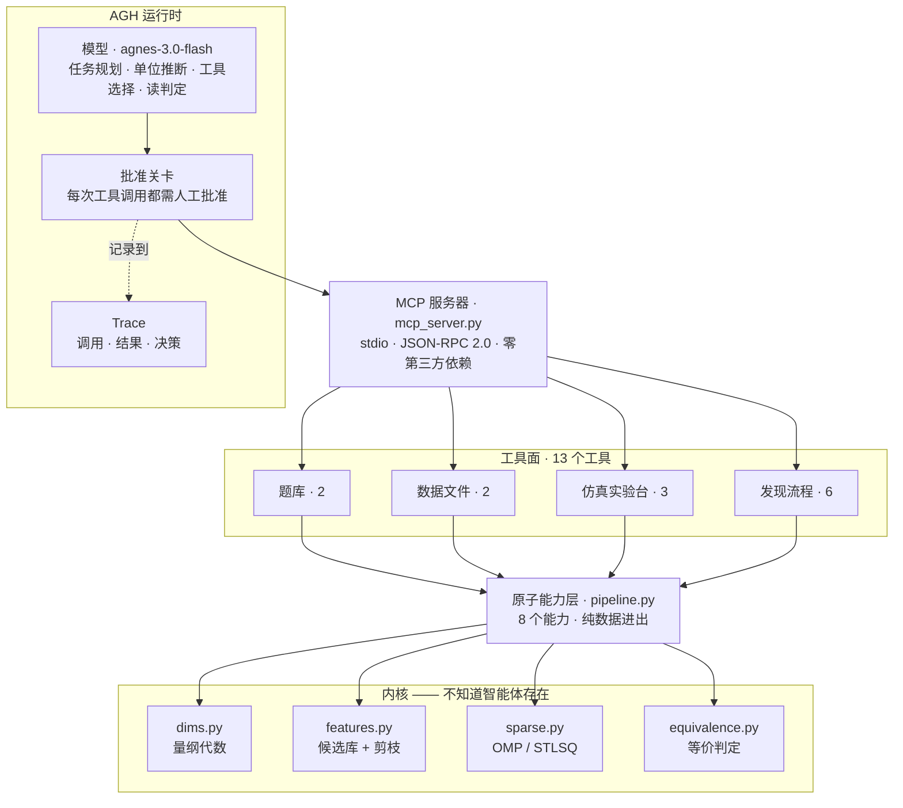

# SciFormula

[English](README.md) | 简体中文

<div align="center">

### 量纲感知的科学定律自动发现

**从带噪声的观测数据里反推出闭式物理公式——在拟合开始之前，先用「量纲齐次」把搜索空间砍掉 99%。**


[快速开始](#快速开始) · [项目介绍](#项目介绍) · [视频介绍](#视频介绍) · [架构介绍](#架构介绍) · [集成标准](#集成标准) · [实验结果](#实验结果) · [English](README.md)

</div>

<p align="center">
  <sub>运行在 <a href="https://github.com/AgnesAI-Labs/agnes-harness">Agnes Harness（AGH）</a> 上：
  13 个工具经 MCP 接入，每次调用都需人工批准，每次调用都留在 trace 里。</sub>
</p>

黑箱模型可以把训练集 R² 做到 0.999，却在离开数据一步之后立刻失效。SciFormula 走的是另一条路：它交出的是一条**闭式公式**，并且用一个物理约束——**物理定律的每一项都必须与目标量同量纲**——在回归之前删掉 99% 的搜索空间。

它追求的不是「拟合得更好」，而是**一个能被外推、被核对、被质疑的答案**。

<details>
<summary><kbd>目录</kbd></summary>

- [项目介绍](#项目介绍)
- [视频介绍](#视频介绍)
- [架构介绍](#架构介绍)
- [集成标准](#集成标准)
- [实验结果](#实验结果)
- [快速开始](#快速开始)
- [仓库结构](#仓库结构)
- [证据与可复现性](#证据与可复现性)
- [已知边界](#已知边界)
- [项目状态](#项目状态)
- [常见问题](#常见问题)
- [许可](#许可)

</details>

> **深度文档在哪。** 逐步推导、每个坑的来龙去脉、以及每个数字怎么复核，都在
> **[docs/technical-notes.zh-CN.md](docs/technical-notes.zh-CN.md)**（一～八节，约 950 行）。
> 仓库里较早的文档与代码注释若写「README 第 N 节」，指的就是那里的第 N 节——**编号原样保留**。

---

## 项目介绍

### 背景：拟合得好，不等于找到了定律

符号回归要做的事，是搜出一个能解释观测数据的表达式。但通用候选库产生的数百万个项里，绝大多数**在物理上根本不可能成立**——`m·v` 永远不可能是能量公式里的一项，因为它的量纲不是能量。

SciFormula 把这个观察变成了核心机制：量纲检查在这里不是事后的合理性检查，而是**拟合之前执行的剪枝步骤**。

这个差别在与黑箱基线的对照里最清楚。同一批 300 组数据（官方 Feynman 基准 100 题 × 3 档噪声），同一套判分口径（`verify_formula` 默认值：区间内 nRMSE ≤ 0.05、外推 nRMSE ≤ 0.20）：

| 方法 | 训练 R²（中位） | 区间内 nRMSE | 外推 nRMSE | 双口径通过率 | 是否给出公式 |
|---|---|---|---|---|---|
| **SciFormula（量纲剪枝 + OMP）** | 1.000 | **0.0041** | **0.0356** | **171 / 300（57%）** | **是** |
| 梯度提升（scikit-learn） | 0.999 | 0.3277 | 0.5461 | 3 / 291（1%） | 否 |
| 随机森林（scikit-learn） | 0.979 | 0.3912 | 0.6128 | 3 / 291（1%） | 否 |

三个方法的训练 R² 几乎一样，通过率却是 **57% 对 1%**。差距全部来自「能不能走出观测区间」——而这恰恰是物理定律本该做到的事。

### 核心功能

- **只读观测数据。** 一个数据集就是一张「变量取值 + 目标量观测值」的 CSV：没有单位，也没有真值公式。单位由模型从变量名与物理语境推断，工具只校验**写法**，不代劳物理判断。
- **构造候选库并剪枝。** 先枚举候选项，再按量纲齐次性筛掉与目标量不同量纲的项。在官方基准上，这一步把 **2,492,610 个候选砍到 22,368 个——99.1%**。
- **稀疏拟合。** 用正交匹配追踪（OMP）挑出少数几项；项数由留出验证集决定，并在「统计上区分不出来」的窄带里选**项数最少**的那个。
- **独立验证，并且允许说「不行」。** `verify_formula` 在训练区间内用新种子重采样、再向区间外扩张 30% 采一批点，并做一道符号合理性检查，给出 `passed` / `invalid` / `implausible` / `underfit` / `overfit`。
- **作为智能体的工具面运行，而不是一段脚本。** 13 个工具全部经 MCP 暴露，AGH 可以自行规划、调用、读反馈、重试——而每一次调用都要人批准。

### 创新亮点

**一、先剪枝再拟合——并且量化剪枝到底值多少。**
消融实验只关掉量纲过滤（`SCIFORMULA_NO_PRUNE=1`），其余流程完全不变：

| 方案 | 无噪声精确恢复 | 双检通过（0 / 1% / 2%） | 保留候选数 |
|---|---|---|---|
| 有剪枝（默认） | **36 / 100** | **54 / 54 / 57** | 22,368 |
| 无剪枝 | 20 / 100 | 29 / 29 / 29 | 63,036 |

这个物理先验价值 **+25 次通过**，代价只是一个过滤器。加速反而是副产品（开发机上 145.7 s → 129.5 s，约 12%；结论是比例，不是绝对秒数）：真正耗时的部分是候选表达式的生成与求值，不是矩阵回归。

**二、一道能拒绝「完美拟合」的验证关卡。**
`P19`（相对论因子）这一题，候选库里**确实有**近似基函数。拟合把 **训练 R² 做到 1.00000**，然后被外推检验以 **R² = −5.20476** 拦下。这个区别很关键：「库里表达不出来」是能力短板；「拟合完美、但被检验拦住了」才是机制在起作用。

在 255 条可验收的官方结果上消融这道关卡，效果可以量化：

| 验收口径 | 放行 | 其中结构错误 | 假阳性率 |
|---|---|---|---|
| 只看训练拟合分（R² ≥ 0.99） | 195 | **5** | **2.6%** |
| + 区间内重采样 | 172 | 0 | **0.0%** |
| + 外推 30% | 171 | 0 | 0.0% |
| + 符号合理性 | 169 | 0 | 0.0% |

真正危险的是那些训练 R² ≈ 0.9999 的错公式。加一道重采样就把它们全清了，代价是误杀 178 条正确公式里的 9 条——这个取舍是刻意做的：放行一条错公式的代价，远大于退回一条对的（智能体还能再试一轮）。

**三、把物理约束写成可执行的规则，而不是写进文档。**
两条规则在代码里强制执行：

- **量纲代数。** 公式先被解析成符号表达式，量纲**沿着表达式结构**递归求出——乘法是指数向量相加、除法相减、求幂乘标量。过程不做任何数值试验，所以任意表达式都能给出确定答案。同一个机制还用于交叉核对「每条方程声明的单位」与「公式实际算出的量纲」是否一致。
- **加性常数只有在目标量无量纲时才合法。** 这条规则是被 AGH 里的智能体踩出来的：截距是**唯一能绕过量纲检查的自由参数**。`0.5·m·v² − 1.204` 过了所有数值关卡（区间内 nRMSE 0.0034），却预测出**负动能**（真值 0.14 处给出 −1.07）。修法是从主张本身推出来的，不是打补丁。

**四、资源可替换，验证可以是一次实验。**
观测数据既可以是磁盘上的文件，也可以来自一台可驱动的数值实验台（RK4 积分，4 个场景）。对仿真数据集，`verify_formula` **在验证时换一组留出参数当场重跑仿真**，拿测得的读数比对——参考事实是当场做出来的实验，不是任何存下来的答案。12 个参数点上，测量值与闭式解的最大相对误差是 **1.5 × 10⁻¹²**。

**五、把「可复现」当成一个被测过的性质，而不是一句承诺。**
早期版本的全量成绩会在 53/53/56 与 52/52/55 之间漂移。根因是 `set` 的迭代序在随机字符串哈希下漏进了「截断保留最简 250 项」这一步。补上全序后，三个不同的 `PYTHONHASHSEED` 跑出逐字节一致的公式。这个问题是**对照实验重跑全量基准时**发现的，不是读代码读出来的。

### 本项目不是什么

- **不是定理证明器。** 「恢复出的公式是不是真值」用**数值等价判定**，不是符号证明。`exact` 的含义是「在测试点覆盖到的范围内一致」。没有 Lean/Coq 级证明，没有形式语义，也没有机器可检查的证明对象。
- **不宣称发现新物理。** 仿真台里的定律是我们自己写进微分方程的。它的价值在于 AGH 能驱动一台可测量、可重复的实验台，而且验证环节真的在做实验。
- **不是通用求解器。** 候选库是有限的：官方 100 题里有 15 题需要库里表达不了的结构，这一点如实标注为能力边界，不藏起来。
- **不是「95% 的方法」。** 内置 21 题教学库是 95.2%，官方 Feynman 基准是 54–57%。两套数字并排给出，就是为了避免前者造成误导。

---

## 视频介绍

| 版本 | 链接 | 语言 | 收录日期 |
|---|---|---|---|
| 中文（主版本） | **[bilibili · BV1YKpu6ECi](https://www.bilibili.com/video/BV1YKpu6ECi)** | 中文 | 2026-10-07 |
| 英文 | **[仓库内 MP4](docs/assets/demo/demo-en.mp4)** — 4:06，1080p | 英文 | 2026-10-29 |

英文版是同一演示流程的英文旁白版，直接存在仓库里（16.9 MB，H.264），不挂在视频平台上：
**录屏本身也是证据的一部分——平台链接会失效，文件不会。**

视频把整个闭环在仿真实验台上走了一遍：选场景 → 驱动一批实验 → 载入落盘的数据集 → 推断单位 → 量纲剪枝 → 拟合 → 验证，并把 AGH 的批准过程一并录进了画面。

**看完可以直接复现，一分钟左右：**

```bash
git clone https://github.com/Arcticfox-star/SciFormula.git
cd SciFormula
pip install numpy sympy
python scripts/run_all.py        # 9 步自检 + 证据校验，约 20 秒
```

---

## 架构介绍

分层的目的是让**智能体走的路径**和**批量评测走的路径**是同一份实现。这里没有「演示路径」和「真实路径」之分。



### 三层，三种职责

| 层 | 文件 | 负责 | 不允许做 |
|---|---|---|---|
| **工具面** | `agh_tools.py`、`mcp_server.py` | 参数校验、JSON 整形、日志、协议 | 含有任何物理逻辑 |
| **原子能力层** | `pipeline.py` | 每个能力只做一件不需要决策的事；智能体与评测共用 | 决定「什么时候停」或「选哪种策略」 |
| **内核** | `dims.py`、`features.py`、`sparse.py`、`equivalence.py` | 数学：量纲向量、候选生成、回归、等价判定 | 知道有智能体存在 |

这样切分有一个很具体的理由：如果编排层没有任何需要判断的东西，那「由智能体跑」就只是外壳。所以凡是能自动化的步骤都被推到内核里，而所有需要判断的事——用哪套单位、剪枝结果是否合理、要不要重试、接不接受这个判定——都留给模型。

### 发现闭环

| # | 阶段 | 工具 | 产出 | 模型要判断什么 |
|---|---|---|---|---|
| 1 | 载入观测 | `load_problem` / `load_dataset` | `data_id` | 选哪道题或哪个数据集 |
| 2 | 推断单位 | `check_units` | 无歧义指数形式、写法警告 | 单位本身——这是唯一的物理输入 |
| 3 | 建库并剪枝 | `build_candidate_library` | `library_id`、保留/总数 | `kept = 0` 是否意味着「重推单位」 |
| 4 | 拟合 | `fit_sparse` | `formula`、可读形式 | 策略与 `max_terms` |
| 5 | 验证 | `verify_formula` | `passed`、`verdict`、理由 | 接受、重试，还是改单位 |
| 6 | 打分（仅基准） | `score_prediction` | 对照真值的判定 | 无——发现模式下这个工具不可用 |

### 几个关键设计决定

| 决定 | 理由 |
|---|---|
| 在拟合前剪枝，而不是拟合后过滤 | 砍掉的都是物理上不可能成立的项，不会误伤可恢复的答案；而且它起的是**正则化**作用，不只是提速 |
| 用 OMP 而不是 STLSQ | STLSQ 依赖训练集上的阈值，在含噪数据上失效；OMP 对共线稳健。两者都保留，`compare_strategies` 可以同场对照，所以这个说法可被检验 |
| 说清是数值等价，不说成证明 | 符号证明是另一条研究路线（Lean/mathlib）。把数值一致说成证明是错的，所以模块说明里就写明它是什么 |
| 目标量有量纲时禁止截距 | 它是唯一逃逸量纲检查的自由参数；放开它会产生物理上不可能的公式 |
| 所有排序都做全序 | 随机的 `set` 迭代序曾让已发布的数字跨进程不可复现 |

重试逻辑放在模型侧，不写死在脚本里：`build_candidate_library` 返回 `candidate_kept = 0` 就回到单位推断；`verify_formula` 返回 `overfit` 就减少项数重拟合。这两条路径在已归档的 AGH 会话里都能看到。

---

## 集成标准

以下都是接口约定。目标是：另一个 harness、或者别人写的脚本，不读源码也能驱动这些能力。

### 传输与协议

| 项 | 取值 |
|---|---|
| 传输 | **MCP over stdio**——按行分隔的 JSON-RPC 2.0，一行一条消息 |
| 服务标识 | `name: "sciformula"`，`version: "0.1.0"` |
| 方法 | `initialize`、`notifications/initialized`、`tools/list`、`tools/call`、`ping` |
| 编码 | stdio 强制 UTF-8（Windows 默认代码页不是 UTF-8） |
| stdout | 只出现协议消息；所有日志重定向到 stderr |
| 依赖 | 仅 Python 标准库，不需要 MCP SDK |

服务器就是一个普通 Python 进程，所以注册时的「可执行文件」填**解释器本体**，脚本路径用独立参数传。这也正是 AGH 官方提醒的做法（不要把整条 shell 命令当可执行文件）。

### 工具契约

13 个工具遵循同一套形状，客户端可以统一处理。

| 方面 | 约定 |
|---|---|
| 入参 | 单个 JSON 对象；传了不认识的参数会被拒绝并列出可用参数；缺必需参数会点名 |
| 成功 | `{"ok": true, ...}` 加上该工具特有字段 |
| 失败 | `{"ok": false, "error": "...", "hint": "..."}`——失败是**反馈**，不是异常 |
| 异常 | `run_tool` 从不抛异常：任何错误都转成可读结果，智能体才知道下一步怎么改 |
| 序列化 | NaN/Inf → `null`，NumPy 类型 → 原生 JSON 类型，输出始终是严格 JSON |
| 串联 | 用不透明 id（`data_id`、`library_id`）向后传递；不从全局状态里猜 |
| 确定性 | 相同输入与种子得到相同输出；结果不依赖时钟或哈希序 |
| 日志 | 每次调用写入本地 JSONL，含耗时与错误类别 |

### 13 个工具

| 工具 | 分组 | 关键参数 | 返回 |
|---|---|---|---|
| `list_problems` | 题库 | `library` | 题目编号、名称、目标量与变量名 |
| `load_problem` | 题库 | `problem_id`、`n_samples`、`noise`、`seed`、`mode` | `data_id`、采样区间、预览——发现模式下**无单位、无公式** |
| `list_datasets` | 数据文件 | — | 数据集名、路径、行数、列名 |
| `load_dataset` | 数据文件 | `name` | `data_id`、统计、预览、验证能力说明 |
| `list_simulations` | 仿真台 | — | 场景编号、可设参数、读数量 |
| `run_simulation` | 仿真台 | `scenario`、`params`、`preview_points` | 完整时间序列（落盘 CSV）与一次读数 |
| `run_sweep` | 仿真台 | `scenario`、`n_cases`、`noise`、`seed` | 「参数 → 读数」数据集 |
| `check_units` | 发现 | `variables_units`、`target_unit`、`data_id` | `parsed_ok`、指数形式、写法警告 |
| `build_candidate_library` | 发现 | `data_id`、`variables_units`、`target_unit`、`max_terms` | `library_id`、总数/保留数、剪枝比例 |
| `fit_sparse` | 发现 | `library_id`、`data_id`、`strategy`、`max_terms`、`threshold` | 全精度公式、可读形式、项数、R² |
| `verify_formula` | 发现 | `formula`、`data_id`、`expand`、`n_samples`、`tol_in_range`、`tol_extrap` | `passed`、`verdict`、理由、区间内/外 nRMSE |
| `compare_strategies` | 发现 | `library_id`、`data_id` | OMP 与 STLSQ 并列对照 |
| `score_prediction` | 发现 | `formula`、`data_id` | 对照真值的判定——**仅基准模式** |

两条刻意的排除：`score_prediction` 在发现模式下直接拒绝工作；事后评分器（`posthoc_eval.py`）**根本不是工具**。真值一旦能在会话内取到，「从数据里发现定律」就退化成「照着答案凑公式」。

### 在 AGH 里注册

```sh
# 1. 注册。--name 是必需参数，显示名不能省。
node packages/cli/dist/local/agnes.mjs mcp add sciformula \
  --name SciFormula \
  --stdio "D:\SciFormula\.venv\Scripts\python.exe" \
  --arg "D:\SciFormula\mcp_server.py"

# 2. 取 revision（只读）。
node packages/cli/dist/local/agnes.mjs mcp get sciformula

# 3. 信任并启用（交互确认）。
node packages/cli/dist/local/agnes.mjs mcp enable sciformula

# 4. 验证：工具数量必须与 `python agh_tools.py list` 一致。
node packages/cli/dist/local/agnes.mjs mcp tools sciformula
```

两条实操要点，都是实测撞到的：

- **写操作需要真实终端。** AGH 判定 `stdin`/`stdout` 不是 TTY 就直接返回失败，且没有跳过开关；用脚本或管道跑会静默报 `operation cancelled`。只读命令不受影响。
- **注册是本机配置，不是仓库状态。** 上面的绝对路径要换成本机实际克隆位置。

### 数据接口

一个观测数据集就是一张普通 CSV，这就是全部的扩展机制：

```
m_0,v,c,m
3.547846749,1.319681636,4.415176658,3.727411286
...
```

| 规则 | 说明 |
|---|---|
| 形状 | 一行表头（变量名）+ 每变量一列 + 目标量一列 |
| 规模 | 仓库自带的数据集每份 200 行 |
| 禁止内容 | 不含单位、不含公式、不含真值——刻意缺席 |
| 命名 | `data/observations/<题目或数据集编号>.csv`；文件名即数据集名 |
| 编码 | UTF-8；带 BOM 的文件按 `utf-8-sig` 读 |
| 替换 | 同格式的 CSV 丢进该目录即可用，一行代码都不用改 |

### 仿真接口

实验台暴露 4 个场景。参数由调用方设定，读数由**对积分轨迹的后处理**得出，绝不直接代入闭式解。

| 场景 | 可设参数 | 仪器读数 | 测量方法 |
|---|---|---|---|
| `spring_period` | `m`、`k`、`A` | 周期 `T` | 过零检测 + 线性插值 |
| `damped_decay` | `m`、`k`、`c`、`A` | 包络衰减常数 `γ` | 峰值包络对数线性回归 |
| `rc_discharge` | `R`、`C`、`V0` | 时间常数 `τ` | `ln V` 对 `t` 线性回归 |
| `kepler_speed` | `M`、`a`、`G` | 比动能 `ε` | 全轨迹平均 |

`A` 与 `V0` 是干扰项：由实验者设定，但不影响读数。把它们留在场景里是有意的——真实实验里常见「看着有关、其实无关」的变量。`run_sweep` 会把一批实验物化成同格式的 CSV 数据集，所以仿真数据与实测数据走的是同一条发现流程。

### 验证标准

`verify_formula` 是唯一的验收关卡，阈值全部显式：

| 参数 | 默认 | 含义 |
|---|---|---|
| `expand` | `0.3` | 外推窗口占训练区间的比例 |
| `n_samples` | `100` | 每个区域新采的点数 |
| `tol_in_range` | `0.05` | 训练区间内的归一化 RMSE 上限 |
| `tol_extrap` | `0.20` | 外推窗口内的归一化 RMSE 上限 |

| 判定 | 条件 | 算不算恢复成功 |
|---|---|---|
| `invalid` | 公式在测试点上无法求值 | 不算 |
| `implausible` | 违反符号合理性（观测同号、预测反号） | 不算 |
| `underfit` | 区间内 nRMSE 超限 | 不算 |
| `overfit` | 区间内可接受，外推超限 | 不算 |
| `passed` | 区间内外都在容差内且符号一致 | **算** |

任何公式都不会仅凭训练拟合被接受。目标量无量纲时允许截距，否则强制为 0。

### 证据标准

可复现性由两份清单支撑，**严格度不同，而这个不同正是关键**：

| 清单 | 覆盖 | 比对方式 |
|---|---|---|
| `results/EVIDENCE.sha256` | 46 项不可变产物：AGH 官方导出、轨迹摘要、评分卡，以及评分卡的判定输入固定副本（`.npz` + `.meta.json`） | 逐字节一致；文本的换行符差异会报告但容忍 |
| `results/SNAPSHOTS.sha256` | 4 项生成产物：`detailed*.csv`、`report*.html` | 按规范形式——先抹掉耗时列与生成时间再比对 |

二进制文件一律逐字节比对、不做换行符容错；AGH 官方导出在 `.gitattributes` 里标 `-text`，git 不做任何转换。`verify_evidence.py` 在任何不匹配时以非 0 退出。

### 运行环境

| 项 | 要求 |
|---|---|
| Python | 3.10 或更高 |
| 直接依赖 | `numpy>=1.24`、`sympy>=1.12`（sympy 会带上 `mpmath`） |
| 硬件 | 不需要 GPU；全量基准在笔记本 CPU 上约 2 分钟 |
| 网络 | 运行时不需要联网 |
| 平台 | Windows / macOS / Linux；MCP 服务器在 stdio 上强制 UTF-8 |

---

## 实验结果

同一份代码、同一套默认配置。两套题库并排给出，因为只报教学库会误导。

**内置教学库——21 题 × 3 档噪声（约 6 秒）：**

| 噪声 | 精确恢复 | 结构判定通过 | 通过双重检验 |
|---|---|---|---|
| 0% | **20 / 21（95.2%）** | 20 / 21 | **20 / 21（95.2%）** |
| 1% | 0 / 21 | 21 / 21 | **20 / 21（95.2%）** |
| 2% | 0 / 21 | 19 / 21 | **20 / 21（95.2%）** |

**官方 Feynman 基准——100 题 × 3 档噪声（约 2 分钟）：**

| 噪声 | 精确恢复 | 结构判定通过 | 通过双重检验 |
|---|---|---|---|
| 0% | **36 / 100** | 58 / 100 | **54 / 100** |
| 1% | 0 / 100 | 61 / 100 | **54 / 100** |
| 2% | 0 / 100 | 59 / 100 | **57 / 100** |

「精确恢复」只在无噪声档有意义：含噪数据里系数不可能被精确复现，所以符号回归领域的通行做法是——符号恢复率在无噪声数据上衡量，鲁棒性在噪声数据上衡量。

**同类方法对比——gplearn 在 1% 噪声整档（100 题）上：**

| 方法 | 结构判定通过 | 外推 nRMSE | 双口径通过 | 单题耗时 |
|---|---|---|---|---|
| **SciFormula** | **61 / 85** | **0.0439** | **58 / 85（68%）** | **0.14 s** |
| gplearn（默认函数集） | 28 / 97 | 0.3518 | 25 / 97（26%） | 5.46 s |
| gplearn（+ sin/cos/tan/exp/tanh） | 17 / 97 | 0.4520 | 13 / 97（13%） | 6.38 s |

一个反直觉的结果被保留下来，因为它支持这套设计：**在固定搜索预算下，把 gplearn 的函数字典变大反而更差**（28/97 → 17/97）。空间变大等于稀释探索效率；先把空间砍掉再花预算，比堆字典有效。

**单位推断——12 张无单位题目卡：**

| 指标 | 结果 |
|---|---|
| 变量级准确率 | **45 / 54（83%）** |
| 题目级准确率 | 6 / 12（50%） |
| 主动声明「无法判断」 | 4 项 |

错误集中在变量名歧义（`sigma`、`Nn`），而不是冷门单位：有明确物理语境的量，包括 `G = N·m²/kg²` 这类，都能推对。推不出来的项，模型会写明「无法判断」，而不是编一个单位。

---

## 快速开始

```bash
git clone https://github.com/Arcticfox-star/SciFormula.git
cd SciFormula
pip install numpy sympy

python scripts/run_all.py        # 9 步自检 + 证据校验
python verify_evidence.py        # 只核证据（46 不可变 + 4 快照）
```

跑官方基准而不是教学库：

```bash
SCIFORMULA_LIBRARY=feynman python experiment.py           # 有量纲剪枝
SCIFORMULA_LIBRARY=feynman SCIFORMULA_NO_PRUNE=1 python experiment.py   # 消融对照
```

> **如果报 `ModuleNotFoundError: No module named 'numpy'`**，是解释器选错了——依赖装在别处（通常是 `.venv`），不是项目坏了。改用 `.venv\Scripts\python.exe`（Windows）或 `.venv/bin/python`。两个入口脚本 `scripts/run_all.py` 与 `scripts/show_test_cases.py` 会自动探测并切换。

要挂到智能体上，按[集成标准](#在-agh-里注册)注册 MCP 服务器即可。不装 AGH 也能单独验证接线是否正确：

```bash
python mcp_server.py --selftest     # 协议、工具清单、一次错误调用、一次真实调用
```

---

## 仓库结构

```
SciFormula/
├── dims.py                  # 量纲代数：7 维指数向量、分数次幂
├── equations.py             # 21 题教学库 + 观测数据生成器
├── features.py              # 候选库构造与量纲剪枝
├── sparse.py                # OMP / STLSQ，含无截距模式
├── equivalence.py           # 数值等价判定
├── pipeline.py              # 原子能力层（8 个能力）
├── agh_tools.py             # 工具注册表：13 个工具、校验、日志
├── mcp_server.py            # MCP 服务器（stdio，零依赖）
├── simulator.py             # RK4 实验台：4 个场景
├── datasets.py              # 磁盘观测数据集接入
├── experiment.py            # 批量基准评测与 HTML 报告
├── verify_evidence.py       # 清单校验（两种严格度）
├── agh_provenance.py        # 模型溯源登账表，可由原件复算
├── posthoc_eval.py          # 会话评分卡（刻意不做成工具）
├── data/
│   ├── FeynmanEquations.csv # 官方 100 题基准
│   └── observations/        # 100 份观测 CSV（无单位、无公式）
├── docs/
│   ├── assets/demo/demo-en.mp4   # 英文演示录屏（4:06，1080p）
│   ├── technical-notes.zh-CN.md  # 深度技术文档（中文）
│   ├── model-declaration.md      # 用了哪个模型、在哪用、怎么调
│   ├── tech-info-declaration.md  # 数据 / 代码 / 求解器 / 接口申报
│   └── test-cases.md             # 正常、边界、失败三类样例与复现命令
├── results/                 # AGH 导出、轨迹、评分卡、清单
└── scripts/                 # run_all、清单重签、基线运行器
```

Python 代码 9,562 行 / 34 个文件（剔除空行与纯注释后 7,701 行），跟踪文件 243 个。

> 想看逐步推导、每个坑的来龙去脉、以及每个数字怎么复核，读
> [`docs/technical-notes.zh-CN.md`](docs/technical-notes.zh-CN.md)（约 950 行，章节编号一～八）。

---

## 证据与可复现性

README 里的每个数字都能重新算出来，证据分三层，互相独立：

| 层次 | 证明什么 | 怎么查 |
|---|---|---|
| 确定性流程 | 结果不依赖机器 | `python scripts/run_all.py`；固定种子，结果里不含时钟 |
| 不可变证据 | 产物生成后没被改过 | `python verify_evidence.py`——46 项逐字节 + 4 项规范形式 |
| 模型溯源 | 实际跑的是哪个模型、每次调用是否有人批准 | `python agh_provenance.py --check`，从 AGH 事件原件复算 |

7 场 AGH 会话以「官方 HTML 导出 + 原始 JSONL 事件流」两种形态归档：2,085 个事件、92 次工具调用、68 次人工批准、4 次被拒。模型名只存在于原始事件日志里，HTML 导出里没有——所以登账表从日志算出，任何人都能重算。

<details>
<summary>归档的 7 场 AGH 会话</summary>

| 会话 ID | 发生了什么 | 工具调用 | 批准（被拒） |
|---|---|---|---|
| `6ea6a59e-2c25-47f8-96b9-e000383a5a93` | RC 放电实验台，演示视频那场——一次通过 | 7 | 7（0）|
| `6501b3a2-515a-4ce2-bce6-6dc59d6a954a` | 理想气体定律——最后三次验证超时，自报失败而不是编造结果 | 10 | 10（0）|
| `9d469c46-1842-49b0-8dc3-21a9f04c6888` | 同一任务在修复之后——通过 | 6 | 6（0）|
| `39d31a09-7e75-42d0-934e-911e92cf6e74` | 候选库剪枝到 0；自主换题；两次 `overfit` 判定 | 19 | 14（3）|
| `438d81fd-c1b5-4efc-b739-d238864a3d3a` | 理想气体方程——单位写法边界，随后自行纠正 | 25 | 6（0）|
| `161ea3fb-7f17-4a89-9ba7-d6c70d46c6be` | 人在任务中途拒绝一次批准；模型如实汇报停在哪一步 | 24 | 24（1）|
| `06df62f6-f32f-41dc-a78b-81c5eb4531be` | 12 张题目卡的单位推断 | 1 | 1（0）|

上表为各场摘要；AGH 自动生成的原始标题为中文。原始事件在 `results/agh-event/`。

</details>

两种失效模式被记录下来而不是藏起来，因为它们都是**验证发现**的，不是读代码读出来的：

- **随机排序**曾让已发布的基准数字跨进程不可复现。
- **评分输入不在版本控制里**，曾让 6 份评分卡在干净克隆后从「恢复成功」静默翻转成「没有公式」。现在判定输入已入库并受保护，且「无法判定」单列为 `unscorable`，不再算成模型的失败。

---

## 已知边界

1. **数值等价不是证明。** 它保证的是「测试点覆盖到的地方一致」，覆盖不到的地方不作保证。
2. **剪枝的前提是没有隐藏的标度常数。** 若真值是 `x/t0` 这种带未标注常数 `t0` 的形式，剪枝会连正确项一起砍掉。
3. **候选库是有限的。** 官方 100 题里有 15 题需要库里表达不了的结构。
4. **验证需要参考解。** 题库数据集与内置真值比对（真值从不返回给智能体）；仿真数据集则当场重跑仿真。完全无参考的版本需要把一部分观测对智能体留出。
5. **智能体路径与评测路径的定位不同。** 基准评测是回归测试，不是智能体的路线；两者调用同一批能力，但只有智能体路径涉及单位推断与重试。

---

## 项目状态

研究原型，为 2026 年 Agnes AI 黑客松的「数学 AI 与形式化推理」方向开发。仓库保持公开、证据链保持可核对；接口仍可能变动。

这个项目的主张很窄，但值得直说：**它想证明的不是 AI 有多强，而是 AI 做出的发现，人能不能看懂、能不能验证。**

---

## 常见问题

**不装 AGH 能跑吗？**
能。智能体调用的每个能力同时也是普通 Python 函数：`python scripts/run_all.py` 会跑完整个流程并校验证据。AGH 只在「智能体路径」上才需要——任务规划、工具选择、批准留痕。

**为什么不直接用 gplearn，或者神经网络？**
神经网络交不出公式。gplearn 能，所以它是公平的对照对象：同一切片上通过率 26% 对 58%，耗时约 40 倍。差别不在回归器，而在**先用物理约束把空间砍掉**。

**95.2% 是主成绩吗？**
不是。那是内置的 21 题教学库。官方 Feynman 基准是 54–57%，两套数字并排给出。只引用前者会误导。

**判定 `passed` 就说明公式是对的？**
不是。它的含义是：在训练区间内的新采样点上、以及向外 30% 的区间内，公式与外部参考一致，且通过了符号检查。「是不是同一个函数」由**数值等价**判定，不是证明。

**运行需要什么？**
Python 3.10+、`numpy`、`sympy`。不需要 GPU、不需要联网、不需要 API key。全量官方基准在笔记本 CPU 上约两分钟。

---

## 许可

[MIT](LICENSE) © 2026 Arcticfox-star。

内置的 Feynman 基准数据保留其原始条款，见 [`data/README.md`](data/README.md)。第三方基线（scikit-learn、gplearn、scipy）仅用于对照，未随仓库分发。

## 致谢

智能体运行时基于 [Agnes Harness](https://github.com/AgnesAI-Labs/agnes-harness)；公开评测集来自 Feynman 符号回归基准。
